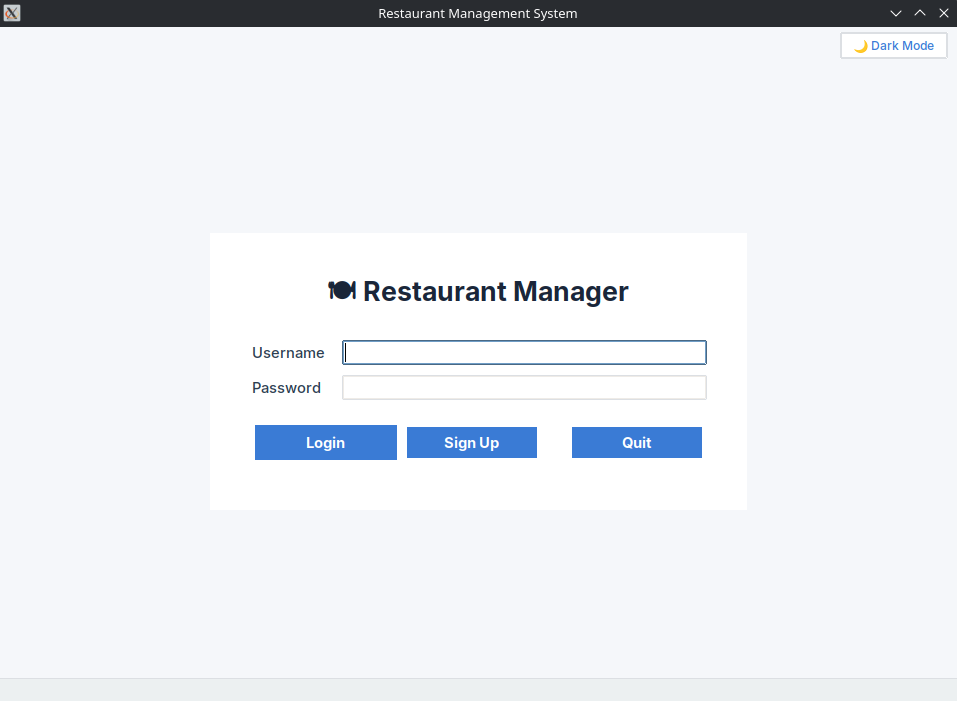
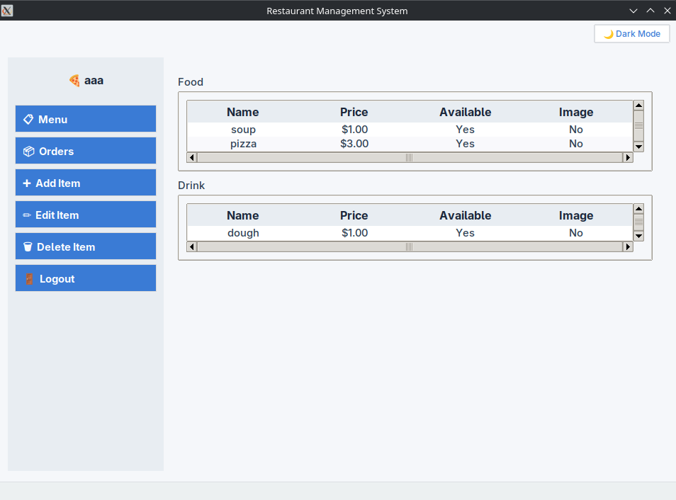
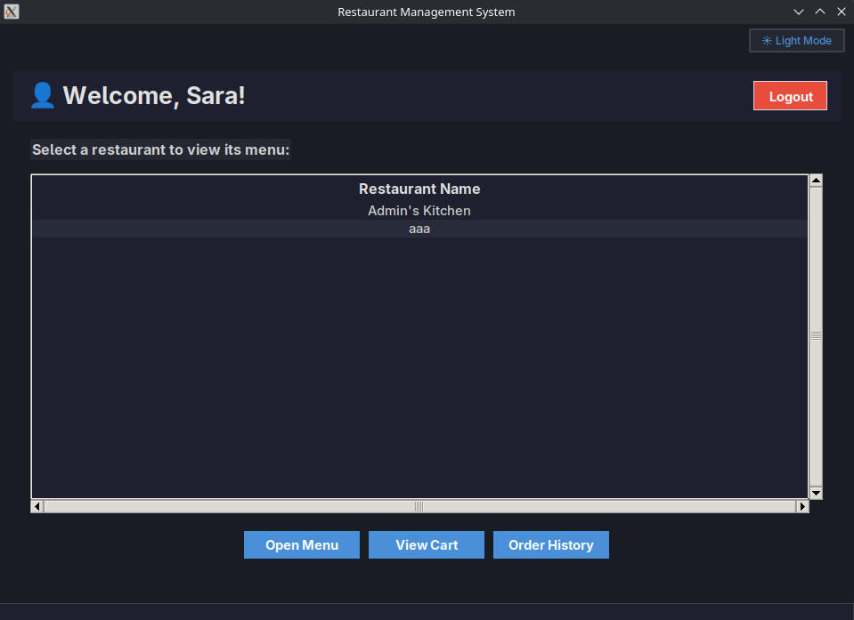

# 🍽️ Restaurant Management System

[](https://www.python.org/)
[](https://docs.python.org/3/library/tkinter.html)
[](LICENSE)

A **desktop application** for managing restaurants, built with **Python** and **Tkinter**.  
Two roles – **Manager** 🧑‍💼 and **Customer** 👤 – with full menu management, cart, and order handling.  
Light 🌙 and dark ☀️ themes, persistent storage with **JSON** or **SQLite**.

---
## 📸 Screenshots

<table>
  <tr>
    <td><br><em>Clean login window (light theme)</em></td>
    <td><br><em>Manager menu (light theme)</em></td>
  </tr>
</table>

<div align="center">
  <br>
  <em>Customer menu with dark theme and cart highlighting.</em>
</div>
---

## 🚀 Features

### 🔐 User Management
- Sign up as **Manager** (requires a restaurant name) or **Customer**
- Secure login/logout
- Validation of names, usernames, and passwords

### 🧑‍💼 Manager Dashboard
- View menu grouped by category (food 🍕, drink 🥤, dessert 🍰)
- Add ➕ / Edit ✏️ / Delete 🗑️ menu items
- Toggle item availability
- Support for item images (requires **Pillow**)
- View all orders placed at the restaurant

### 👤 Customer Dashboard
- Browse a list of restaurants
- View each restaurant’s menu with availability status
- Add items to cart 🛒 (across multiple restaurants)
- Checkout to place orders (creates a combined order per‑restaurant)
- View order history with timestamps

### 🎨 User Interface
- Clean, modern Tkinter GUI
- **Light & dark themes** toggle 🎛️
- Interactive sidebar navigation
- Treeviews with alternating row colors and cart highlighting
- Status bar for feedback messages

### 💾 Flexible Storage
- JSON file (`data.json`) – simple, human‑readable, no extra dependencies
- SQLite database (`data.db`) – for scalability and concurrent access
- Easily switch by editing one variable (`STORAGE_TYPE`) in `storage.py`

---

## 📦 Installation

1. **Clone the repository**
   ```bash
   git clone https://github.com/AradPilevarJavid/snap-food
   cd snap-food
   ```

2. **Install Python 3.8+** if not already installed.

3. **(Optional) Install Pillow** for image support:
   ```bash
   pip install -r requirements.txt
   ```
   > The app runs fine without Pillow – menu images will simply not be displayed.

4. **Run the application**
   ```bash
   python src/main.py
   ```

---

## ▶️ Usage

### Default accounts (preloaded)
| Role     | Username | Password |
|----------|----------|----------|
| Manager  | `admin`  | `123456` |
| Manager  | `manager2` | `123456` |
| Customer | `user`   | `123456` |

### Manager flow
1. Log in as a manager (e.g., `admin` / `123456`).
2. Use the sidebar to:
   - Browse your menu (📋 Menu)
   - Add new items (➕ Add Item)
   - Edit/delete existing items
   - View incoming orders (📦 Orders)

### Customer flow
1. Log in as `user` / `123456`.
2. Select a restaurant from the list and click **Open Menu**.
3. In the menu window, add items to cart.
4. Click **View Cart** to review and **Checkout**.
5. Check **Order History** for past orders.

### Changing storage backend
Edit the `STORAGE_TYPE` variable in `src/storage.py`:
```python
# Use SQLite
STORAGE_TYPE = "sqlite"

# Use JSON (default)
STORAGE_TYPE = "anything_else"
```
> On first run with a new storage type, default restaurants/users are created automatically.

---

## 📁 Project Structure

```
📦 restaurant-management-system
├── 📄 LICENSE
├── 📄 requirements.txt
└── 📂 src
    ├── 🐍 main.py              # Entry point
    ├── 🖼️ gui.py               # Tkinter GUI (light/dark themes)
    ├── 📦 models.py            # User, Manager, Customer, MenuItem, Order, Restaurant
    ├── ⚙️ platform_core.py     # Core logic (auth, cart, checkout, data loading)
    └── 💾 storage.py           # JSON & SQLite storage backends
```

---

## 🛠️ Technologies

- **Python 3** – core language
- **Tkinter** – GUI toolkit
- **Pillow** (optional) – image handling
- **sqlite3** – built‑in SQLite support
- **json** – JSON serialisation
- **ABC** – abstract base classes for storage

---

## 📜 License

This project is licensed under the **MIT License** – see the [LICENSE](LICENSE) file for details.


---

## 🌟 Future Enhancements

- [ ] Image uploads instead of file paths  
- [ ] Search and filter menu items  
- [ ] Order status tracking (pending, in progress, delivered)  
- [ ] Export orders to PDF/Excel  
- [ ] Multi‑language support  
- [ ] Packaging as a standalone executable  

---
